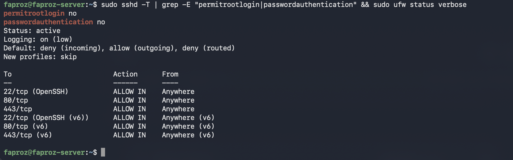
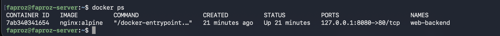
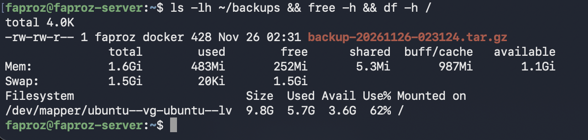

# Secure Linux Web Infrastructure & Automated Operations Lab

Proyek simulasi administrasi sistem *end-to-end* pada lingkungan **Ubuntu 26.04.1 LTS (ARM64)** untuk membangun infrastruktur web yang aman, terisolasi, dan terotomatisasi.

## Arsitektur Sistem

    [Client / Browser (macOS)]
             │
             ▼ (HTTP Port 80 - Public Entry)
    [UFW Firewall (Allow 22, 80, 443)]
             │
             ▼
    [Nginx Reverse Proxy (127.0.0.1:80)]
             │
             ▼ (Internal Loopback Port 8080)
    [Docker Container: web-backend (nginx:alpine)]
             │
             ▼
    [Automated Cron Backup (.tar.gz + 7-Day Retention)]

## Implementasi Teknis
1. **System Recovery & SSH Hardening**
   - Memulihkan akses sistem melalui parameter kernel GRUB (`rw init=/bin/bash`).
   - Mengamankan akses *remote* menggunakan pasangan kunci kriptografi **Ed25519**, serta menonaktifkan login `root` (`PermitRootLogin no`) dan autentikasi kata sandi (`PasswordAuthentication no`).
2. **Network Security & Firewall (UFW)**
   - Menerapkan kebijakan *default deny incoming* dan hanya membuka port esensial (`22/tcp`, `80/tcp`, `443/tcp`).
   - Melakukan audit soket jaringan aktif menggunakan `ss -tulpn` untuk memastikan tidak ada layanan tidak sah yang terekspos.
3. **Reverse Proxy & Containerization**
   - Mengisolasi aplikasi *backend* di dalam container **Docker (`nginx:alpine`)** yang diikat khusus ke alamat lokal (`127.0.0.1:8080`) dengan volume *read-only* dan kebijakan `--restart unless-stopped`.
   - Mengonfigurasi **Nginx** sebagai *reverse proxy* di port `80` untuk meneruskan trafik eksternal ke container internal secara aman.
4. **Automated Backup & Resource Monitoring**
   - Membuat skrip Bash terotomatisasi via **Cronjob** harian untuk mengarsipkan konfigurasi Nginx dan data web ke format `.tar.gz` dengan retensi otomatis 7 hari.
   - Memantau kesehatan memori, kapasitas disk, dan log akses container (`free -h`, `df -h`, `docker logs`).

## Dokumentasi Hasil

